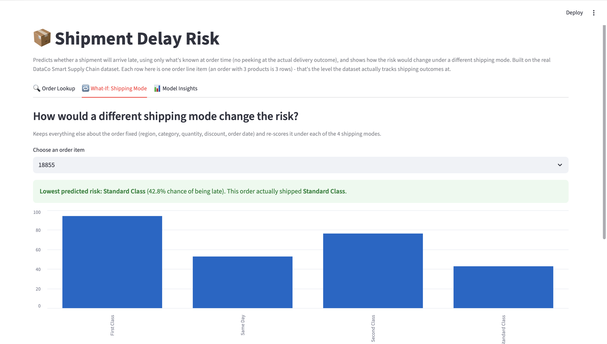

# Shipment Delay Risk

A late-delivery-risk classifier plus a shipping-mode "what-if" tool, built
on the real DataCo Smart Supply Chain dataset (~180K actual order line
items, not simulated). Basically pretending to be a logistics analyst
trying to answer "is this order going to be late, and would picking a
different shipping mode actually help?"



## About the data

[DataCo Smart Supply Chain for Big Data Analysis](https://data.mendeley.com/datasets/8gx2fvg2k6/5)
is a public dataset of ~180,500 real order line items from a global
retailer - shipping mode, order region/market, product category,
quantity, discount, and (critically) both the *scheduled* and *actual*
number of days each shipment took. That real/scheduled gap is what
`Late_delivery_risk` is built from.

I dropped the ~7,750 rows marked "Shipping canceled." Those get coded as
`Late_delivery_risk = 0` in the raw data, which would just teach a model
that a canceled order looks identical to an on-time one - a cancellation
isn't really a delivery outcome at all. 172,765 rows are left, of which
57.3% were late.

The dataset also ships with a full (fake) customer record per row,
including a plaintext "Customer Password" column. None of that is
real PII - it's synthetic test data - but I dropped it immediately on
load anyway and never use or display it, same as I'd treat it if it
were real.

## What it does

### The leakage problem (the part I spent the most time on)
The raw data puts the actual outcome right next to the order-time
features: `Days for shipping (real)`, `Delivery Status`, even the actual
`shipping date`. A model trained with those in the feature set isn't
predicting anything - it's reading the answer key. I built the feature
set backwards from the question "what would I actually know about this
order before it ships?" and excluded everything else
(`src/prepare_data.py` has the full list under `LEAK_COLUMNS`, with the
reasoning for each one).

What's actually in the model: shipping mode, order region/market,
product category/department, customer segment, order quantity, discount
rate, product price, and order day-of-week/month. No actual shipping
dates, no delivery status, no profit fields (some of those get finalized
after the order resolves too).

### The model
Random Forest vs. a Logistic Regression baseline, same comparison as my
Retention Lab project, plus the simplest possible baseline: predicting
each order's late risk as just the historical late rate for its shipping
mode. The train/test split is done by order, not by line item, so items
from the same order never end up on both sides.

| Model | ROC-AUC |
|---|---|
| Shipping mode only (late rate per mode) | 0.738 |
| Logistic Regression | 0.739 |
| Random Forest | 0.739 |

69% accuracy at the default threshold, 84% precision / 57% recall on the
"late" class. Neither model beats the shipping-mode-only baseline in any
meaningful way - the signal here is almost entirely in one feature, which
is the more interesting finding

### Shipping Mode explains almost everything
Feature importance says `Shipping Mode` alone accounts for **96% of the
model's total importance**. At first I read that as a red flag (did I
leak something?) but the actual late-rates by mode explain it, and the
story underneath is kind of the whole point of this project:

| Shipping Mode | Scheduled days | Actual days (median) | Late rate |
|---|---|---|---|
| First Class | 1 | 2 | **100%** |
| Second Class | 2 | 4 | 80% |
| Same Day | 0 | 0 | 48% |
| Standard Class | 4 | 4 | 40% |

The real fulfillment time barely depends on which mode the customer
picked - Second Class and Standard Class ship in basically the same
~4 days on average, regardless of the fact that Second Class promises 2.
First Class is **always** late (zero exceptions in 26,513 orders) because
it promises 1 day but nothing actually ships that fast. So "late" here
isn't mostly about which mode is slower in practice - it's about which
mode made a promise the fulfillment process can't keep. That's a much
more actionable finding for a real ops team than "ship things faster
would help": the fix for First Class isn't picking a faster carrier, it's
fixing the SLA or the handoff process behind it.

Region and market, by comparison, barely move the needle (within
Standard Class alone, late rates range from about 30% in Canada to 44%
in Central Africa - real, but small next to the ~60-point gap between
shipping modes).

### What-if: shipping mode comparison
For any order, the app holds everything else fixed and re-scores the
same order under all 4 shipping modes, so it's not just "here's the
risk" but "here's which mode would actually lower it." Given the finding
above, this mostly surfaces the mode-level base rates rather than a lot
of order-specific nuance - which is itself a useful, honest thing for
the tool to show: it's telling you the real lever here isn't the
customer or the product, it's the SLA.

### The app
Streamlit app with three tabs: look up an order's predicted risk, the
shipping-mode what-if comparison, and model insights (feature
importance, late rate by mode, model metrics).

## Built with
Python, pandas, scikit-learn, Streamlit

## Running it

```bash
git clone https://github.com/brookelee8519/shipment-delay-risk.git
cd shipment-delay-risk
pip install -r requirements.txt
```

Download the dataset from
[Mendeley Data](https://data.mendeley.com/datasets/8gx2fvg2k6/5) or
[Kaggle](https://www.kaggle.com/datasets/shashwatwork/dataco-smart-supply-chain-for-big-data-analysis)
("DataCo Smart Supply Chain for Big Data Analysis") and place
`DataCoSupplyChainDataset.csv` in `data/`. It's not included in this repo
- it's a third-party dataset with its own license, and it's ~95MB.

```bash
python3 -m src.prepare_data
python3 -m src.train_model
streamlit run app/app.py
```

## Stuff that's not perfect / what I'd fix with more time

- Shipping Mode dominating the model means the other features aren't
  doing much work. A version with real carrier-level data (which actual
  carrier, actual transit route, warehouse origin) would probably find
  more order-specific signal instead of mostly re-deriving the SLA
  structure.
- The model's at a flat 0.5 decision threshold; a real version would
  tune it the way I did in Retention Lab (weighing the cost of a missed
  "will be late" flag against a false alarm).
- Order region has a real but modest effect that the model barely uses
  (collapsed into one of ~100 one-hot columns alongside market and
  category). A hierarchical or target-encoded version of region might
  pull out more of that signal.
- This is a single retailer's historical data, so "Standard Class is
  usually fine, First Class is structurally broken" is a finding about
  *this* dataset's SLAs and fulfillment process, not a universal claim
  about shipping speed.
